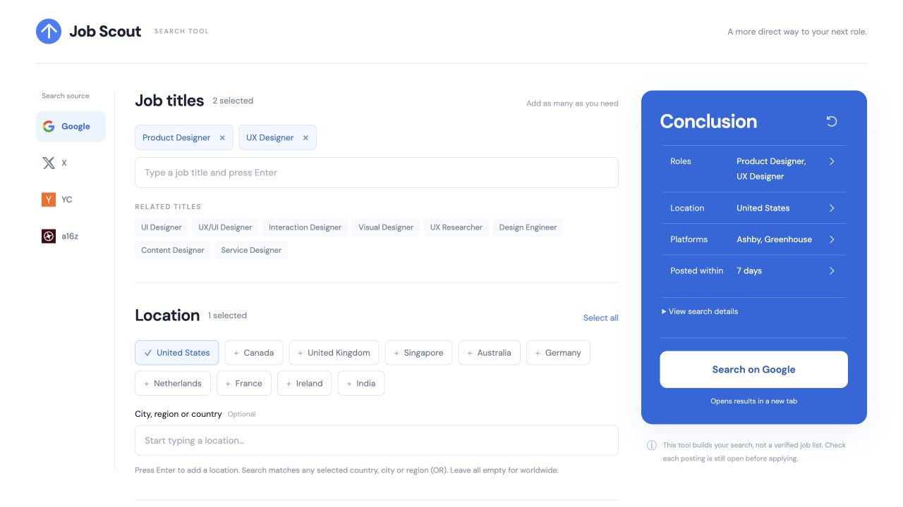

# Job Scout

### Less setup. More searching.

[Try Job Scout ↗](https://job-scout-search.vercel.app/)

Job Scout turns the setup for searching across Google, X, YC, and a16z into simple choices. I designed it around my own job search, with the goal of reducing repeated typing and making preferences easier to reuse.

**My role:** Problem framing, product and interaction design, and iterative review, with Codex supporting implementation, testing, and deployment.

## 1. Finding the friction

I wanted to find Product Designer and UX Designer opportunities across company career pages, startup job boards, and hiring posts. Each platform made me express the same intent differently.

I focused on three questions: How could I reduce repeated input? What could carry over between platforms? How could users see what their search would actually include?

## 2. Making choices easier than typing

An early version offered plenty of search fields, but still required too much effort to get started. I shifted toward visible options: suggested titles, hiring phrases, locations, and common filters.

Frequently used choices appear first, with **Show more** for longer lists and custom input when needed. Users can start with a few selections and refine their search as they go.

## 3. Reusing intent across platforms

I realized that carrying over preferences required understanding what each platform could support. A job title might become a keyword on one platform and a role category on another.

I designed compatible preferences to carry over automatically, while keeping platform-specific choices separate and making unapplied conditions available to review.

## 4. Keeping the next action clear

As the tool grew, I removed large headings and repetitive explanations so users could reach the controls immediately.

A live summary shows the current search and provides a direct way back to each setting. Selection counts, a visible search button, and returning to the top when switching platforms help users stay oriented.

## 5. What I built and learned

Job Scout is live on Vercel. It saves preferences in the browser and opens searches on the selected platform. It does not aggregate or verify job listings.

The design evolved through my own use, checking destination filters, and functional testing. Formal usability research and measured efficiency gains are still ahead.

My main takeaway: making a tool simpler means deciding which work it can handle for the user—and making the remaining choices easy to understand.

**[Explore the live tool ↗](https://job-scout-search.vercel.app/)**
